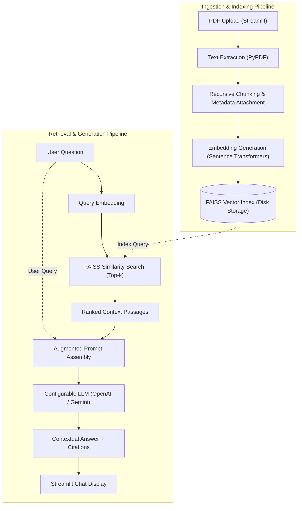

# SmartDocs – Generative AI Document Assistant

[](https://www.python.org/)
[](LICENSE)
[](#development-status)
[](https://python.langchain.com/)

SmartDocs is a modern **Retrieval-Augmented Generation (RAG)** application designed to transform complex, multi-page PDF documents into interactive, queryable knowledge sources. By combining dense semantic embeddings, high-performance vector indexing, and state-of-the-art Large Language Models (LLMs), SmartDocs allows users to upload documents, ask natural language questions, and receive precise, context-grounded answers backed by explicit source citations.

---

> [!IMPORTANT]
> ### 🚧 Development Status: Phase 1 (Foundation & Architecture)
> SmartDocs is currently under active development.
> - **Phase 1 (Current)**: Project structure, dependency management, documentation, architectural blueprints, and module interfaces are established.
> - **Phase 2 (Upcoming)**: End-to-end integration of PDF parsing, embedding generation, FAISS indexing, LLM response chains, and interactive Streamlit chat.

---

## 📌 Problem Statement

Knowledge workers, researchers, legal analysts, and students routinely interact with dense PDF documents (research papers, contracts, manuals, and financial reports). Traditional document review presents distinct challenges:
1. **Time-Intensive Manual Review**: Searching through hundreds of pages for specific answers is inefficient.
2. **Brittle Keyword Search**: Conventional `Ctrl+F` queries fail when questions use synonyms, paraphrased concepts, or require conceptual synthesis.
3. **LLM Hallucinations**: Standard off-the-shelf generative models lack access to proprietary or private local documents and often generate plausible but inaccurate assertions when queried outside their training data.

---

## 🎯 Project Objectives

- **Context-Grounded Accuracy**: Restrict model answers strictly to extracted document excerpts to eliminate hallucinations.
- **Traceable Attribution**: Ensure every response provides direct citations (document name, page number, and relevant text passage).
- **Local Semantic Search**: Leverage local Sentence Transformers and FAISS to minimize external embedding API costs and reduce retrieval latency.
- **Provider Agnostic**: Support seamless switching between LLM providers (e.g., OpenAI, Google Gemini, Anthropic, or local models via Ollama).
- **Intuitive User Experience**: Deliver an accessible web interface built with Streamlit for frictionless document uploads and conversational querying.

---

## 🚀 Planned Features

- [x] **Repository & Architecture Foundation**: Modular project hierarchy, interface contracts, and clean dependency management.
- [ ] **Multi-Document PDF Ingestion**: Robust text extraction across multiple files using `PyPDF`.
- [ ] **Semantic Chunking**: Overlapping recursive character text splitting to maintain cross-boundary context.
- [ ] **Local Dense Embeddings**: 384-dimensional dense vector embeddings using `sentence-transformers/all-MiniLM-L6-v2`.
- [ ] **Persistent FAISS Vector Indexing**: Disk-persisted vector storage for fast, sub-second nearest-neighbor similarity search.
- [ ] **Configurable LLM Support**: Dynamic orchestration through LangChain for OpenAI (`gpt-4o-mini`), Google Gemini, Anthropic, or Ollama.
- [ ] **Interactive Streamlit Web Interface**: Conversational chat interface, sidebar parameter tuning (chunk size, overlap, top-$k$), and expandable source drawers.

---

## 🛠️ Technology Stack

| Layer | Technology | Purpose |
| :--- | :--- | :--- |
| **Language** | [Python 3.10+](https://www.python.org/) | Core programming language |
| **User Interface** | [Streamlit](https://streamlit.io/) | Interactive web dashboard and conversational interface |
| **RAG Orchestration** | [LangChain](https://www.langchain.com/) | Prompt pipelining, chunking strategies, and LLM abstraction |
| **Vector Database** | [FAISS](https://github.com/facebookresearch/faiss) | Local high-speed vector index for similarity retrieval |
| **Embedding Model** | [Sentence Transformers](https://www.sbert.net/) (`all-MiniLM-L6-v2`) | Local dense semantic text vectorization |
| **PDF Extraction** | [PyPDF](https://pypdf.readthedocs.io/) | Document text and page metadata extraction |
| **LLM Providers** | [OpenAI](https://openai.com/) / [Google](https://ai.google.dev/) | Primary language generation engines |
| **Testing** | [pytest](https://pytest.org/) | Unit and integration testing |

---

## 🏛️ RAG Architecture & Workflow

SmartDocs implements a two-stage RAG workflow consisting of an **Ingestion Pipeline** and a **Retrieval & Generation Pipeline**.



For complete technical specifications, component contracts, and design considerations, refer to [architecture.md](docs/architecture.md).

---

## 📁 Project Folder Structure

```
SmartDocs/
├── app.py                      # Streamlit application UI & entry point
├── requirements.txt            # Project dependencies and version pins
├── README.md                   # Comprehensive repository documentation
├── .gitignore                  # Git exclusion rules for environments, caches, & secrets
├── .env.example                # Template for environment variables and API keys
├── LICENSE                     # MIT open-source license
├── src/                        # Core application source code
│   ├── __init__.py             # Package initialization and metadata
│   ├── document_processor.py   # PDF text extraction and recursive chunking
│   ├── embeddings.py           # Embedding model loader and vectorization
│   ├── vector_store.py         # FAISS vector index management and persistence
│   └── rag_pipeline.py         # End-to-end RAG retrieval and LLM orchestration
├── tests/                      # Automated unit and integration tests
│   └── __init__.py             # Test package initialization
├── data/                       # Local directory for documents and vector indices
│   └── .gitkeep                # Keeps directory in Git while ignoring data artifacts
└── docs/                       # Detailed design and architectural documentation
    └── architecture.md         # Detailed RAG pipeline specifications
```

---

## ⚙️ Installation Instructions

### Prerequisites
- Python 3.10, 3.11, or 3.12 installed on your system.
- Git installed on your system.

### 1. Clone the Repository
```bash
git clone https://github.com/gaganhg08/SmartDocs.git
cd SmartDocs
```

### 2. Create and Activate a Virtual Environment

**On Linux/macOS:**
```bash
python -m venv .venv
source .venv/bin/activate
```

**On Windows (PowerShell):**
```powershell
python -m venv .venv
.venv\Scripts\Activate.ps1
```

### 3. Install Dependencies
```bash
pip install --upgrade pip
pip install -r requirements.txt
```

---

## 🔑 Environment Variable Configuration

1. Copy the example environment file:
   ```bash
   cp .env.example .env
   ```
   *(On Windows PowerShell: `Copy-Item .env.example .env`)*

2. Open `.env` in your text editor and supply your API keys:

| Variable | Description | Default / Example |
| :--- | :--- | :--- |
| `LLM_PROVIDER` | Active LLM backend (`openai`, `google`, `anthropic`, `ollama`) | `openai` |
| `OPENAI_API_KEY` | OpenAI API access token | `sk-...` |
| `OPENAI_MODEL_NAME` | Model identifier | `gpt-4o-mini` |
| `EMBEDDING_MODEL_NAME`| HuggingFace embedding model identifier | `sentence-transformers/all-MiniLM-L6-v2` |
| `CHUNK_SIZE` | Maximum characters per chunk | `1000` |
| `CHUNK_OVERLAP` | Overlapping characters between adjacent chunks | `200` |
| `TOP_K_RETRIEVAL` | Number of context chunks passed to the LLM | `4` |
| `VECTOR_STORE_DIR` | Local disk storage path for FAISS index | `./data/faiss_index` |

> [!WARNING]
> Never commit your `.env` file to version control. It is excluded by default in `.gitignore`.

---

## 💻 Usage Instructions

Once the dependencies and environment variables are configured, launch the Streamlit dashboard:

```bash
streamlit run app.py
```

The application will be accessible in your web browser at `http://localhost:8501`.

---

## 🧪 Testing Instructions

Run the automated test suite using `pytest`:

```bash
# Run all tests
pytest

# Run tests with verbose output
pytest -v

# Run tests with coverage reporting
pytest --cov=src
```

---

## 🔮 Future Enhancements

- **Hybrid Search**: Combine dense semantic embeddings with sparse keyword search (BM25) via reciprocal rank fusion (RRF).
- **Reranking**: Integrate cross-encoder rerankers (e.g., Cohere or BGE reranker) for improved passage relevance.
- **OCR Support**: Incorporate OCR (e.g., Tesseract or unstructured) for scanned and image-heavy PDFs.
- **Multi-Turn Memory**: Enable session memory with sliding window context summarization.
- **Dockerization**: Provide a multi-stage Dockerfile and `docker-compose.yml` for unified local deployment.

---

## 👤 Author

**Gagan H G**
- GitHub: [@gaganhg08](https://github.com/gaganhg08)

---

## 📄 License

This project is licensed under the MIT License - see the [LICENSE](LICENSE) file for details.
