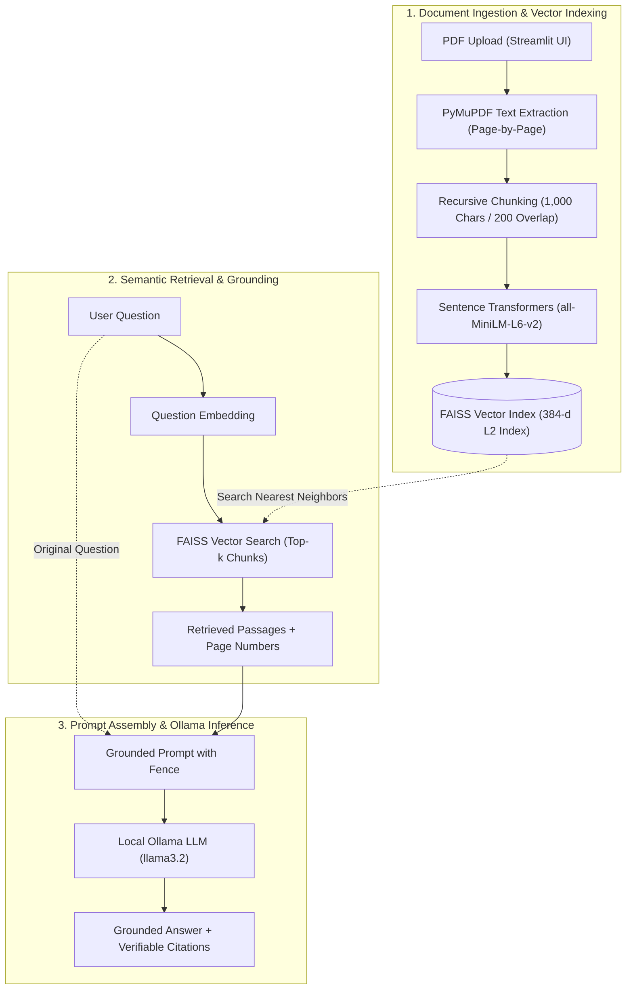

# SmartDocs – Generative AI Document Assistant

[](https://github.com/gaganhg08/SmartDocs)
[](https://www.python.org/)
[-0078D6.svg)](https://microsoft.com/windows)
[](LICENSE)
[](#features)
[](https://python.langchain.com/)
[-purple.svg)](https://ollama.ai/)

**SmartDocs** is a local, privacy-first **Retrieval-Augmented Generation (RAG)** assistant designed to transform multi-page PDF documents into interactive, queryable knowledge sources. Built with **PyMuPDF**, **Sentence Transformers**, **FAISS**, and **Ollama**, SmartDocs allows users to upload documents, search document content semantically, and ask natural language questions with context-grounded answers backed by explicit source citations.

---

## 💻 Hardware & Storage Requirements

SmartDocs is designed to run completely offline on a consumer Windows PC without requiring paid cloud API keys.

| Component | Model / Tool | Disk Storage | RAM / VRAM | Compute Device |
| :--- | :--- | :--- | :--- | :--- |
| **Python & Packages** | Virtual Environment (`.venv`) | ~1.5 GB | ~300 MB | CPU |
| **Embeddings** | `sentence-transformers/all-MiniLM-L6-v2` | ~90 MB | ~300 MB | CPU (or CUDA GPU) |
| **Local LLM (Default)** | Meta `llama3.2` (3B Parameters) | ~2.0 GB | ~3.8 GB RAM/VRAM | CPU (AVX2) or NVIDIA GPU |
| **Total System Minimum** | *Entry-Level Configuration* | **~4.0 GB free disk** | **8 GB System RAM** | Modern multi-core CPU |
| **Total Recommended** | *Optimal Configuration* | **~10.0 GB free disk** | **16 GB RAM + RTX GPU** | NVIDIA GPU (4GB+ VRAM) |

### Alternative Model Options for Different Hardware Specs:
- **Low-Spec PCs (4 GB – 8 GB RAM)**: Use `llama3.2:1b` (1.3 GB download, ~1.5 GB RAM) or `phi3:mini` (2.3 GB download).
- **High-Spec PCs (16 GB+ RAM / 8 GB+ VRAM GPU)**: Use `mistral:7b` (4.1 GB download) or `llama3.1:8b` (4.7 GB download).

---

## 🚀 Key Features

1. **Robust PDF Ingestion & Validation**
   - File extension and `%PDF-` magic header validation.
   - Configurable file-size limit enforcement (default: 20MB).
   - Graceful handling of empty, corrupted, and password-protected PDFs with user-friendly errors.

2. **PyMuPDF Text Extraction**
   - Page-by-page text parsing preserving 1-indexed page numbers.
   - Automatic detection of scanned or image-only PDFs lacking extractable text.
   - Clear notifications informing the user when a scanned document requires OCR.

3. **Semantic Text Chunking**
   - Recursive character chunking preserving sentence and paragraph integrity.
   - Configurable chunk size and chunk overlap.
   - Full metadata tracking for every chunk (`source`, `page`, `chunk_index`, `chunk_id`).

4. **Local Sentence Transformers Embeddings**
   - 384-dimensional dense vectors using `sentence-transformers/all-MiniLM-L6-v2`.
   - Cached model loading via `@st.cache_resource` for low latency and zero duplicate memory overhead.
   - Offline-resilient operation with no simulated or fake embeddings.

5. **FAISS Vector Indexing & Session Isolation**
   - High-performance semantic similarity retrieval (`faiss-cpu`).
   - Dynamic index rebuilding when documents are uploaded or removed.
   - Strict session isolation using Streamlit session state to prevent cross-user data leakage.

6. **Grounded RAG Pipeline & Ollama Inference**
   - Interfacing with local Ollama models (e.g. `llama3.2`, `mistral`, `gemma2`).
   - Anti-hallucination prompting: when context is insufficient, explicitly states that uploaded documents do not contain enough information.
   - Prompt injection mitigation: untrusted document context is fenced inside `<DOCUMENT_CONTEXT>` boundaries.
   - Complete absence of fake or simulated responses when the model is unavailable.

7. **Hierarchical Document Summarization**
   - Dedicated "Summarize Document" action for any uploaded PDF.
   - Single-pass summarization for concise documents within model context limits.
   - Section-by-section map-reduce synthesis for long multi-page documents, ensuring no silent truncation.
   - Clear distinction between generated summaries and original extracted text.
   - Transparent warnings if pages are unreadable or skipped.

8. **Document Management & Interactive UI**
   - Two intuitive operational modes: **💬 Natural-Language Q&A** and **📝 Document Summarizer**.
   - Real-time document manager in the sidebar showing file size, page count, chunk count, and index status.
   - Individual document deletion with instant vector index rebuilding.
   - "Clear All Session Data" action for instant cleanup.
   - Expandable source citation drawers displaying relevance score, file name, page number, and exact text excerpts.

---

## 🛠️ Technology Stack

| Layer | Technology | Purpose |
| :--- | :--- | :--- |
| **Language** | Python 3.10, 3.11, 3.12, 3.13 (64-bit) | Core programming language (3.11/3.12 recommended) |
| **User Interface** | [Streamlit](https://streamlit.io/) | Responsive web application and conversational UI |
| **PDF Extraction** | [PyMuPDF](https://pymupdf.readthedocs.io/) | High-speed page-by-page PDF extraction |
| **RAG Orchestration** | [LangChain](https://www.langchain.com/) | Chunking strategies, document abstractions, embeddings adapter |
| **Vector Database** | [FAISS](https://github.com/facebookresearch/faiss) (`faiss-cpu`) | High-speed vector index for similarity retrieval |
| **Embedding Model** | [Sentence Transformers](https://www.sbert.net/) (`all-MiniLM-L6-v2`) | Local dense semantic text vectorization |
| **LLM Provider** | [Ollama](https://ollama.ai/) | Local LLM inference (`llama3.2`, `mistral`, etc.) |
| **Testing** | [pytest](https://pytest.org/) | Unit and integration test suite (41 tests) |

---

## 📁 Project Structure

```
SmartDocs/
├── app.py                      # Streamlit application UI & entry point
├── requirements.txt            # Python dependencies
├── .env.example                # Configuration template
├── .env                        # Active environment configuration (git-ignored)
├── .gitignore                  # Git privacy & security exclusions
├── setup_windows.ps1           # Automated Windows setup & verification script
├── run_app.ps1                 # One-click Windows application launcher
├── pytest.ini                  # Pytest test discovery & warnings configuration
├── src/                        # Core application modules
│   ├── __init__.py             # Package exports & Windows thread safeguards
│   ├── document_processor.py   # PDF validation, PyMuPDF extraction, recursive chunking
│   ├── embeddings.py           # Sentence Transformers management & LangChain adapter
│   ├── vector_store.py         # FAISS vector store, similarity search, index rebuilding
│   ├── rag_pipeline.py         # Grounded prompt synthesis, injection defense, Ollama client
│   └── summarizer.py           # Hierarchical section-by-section document summarizer
├── tests/                      # Automated test suite (41 tests, 100% pass)
│   ├── __init__.py
│   ├── conftest.py             # Test fixtures and Windows environment configuration
│   ├── test_document_processor.py  # Validation, extraction, scanned detection, chunking
│   ├── test_embeddings.py          # Model loading, vector dimensions, queries
│   ├── test_vector_store.py        # FAISS search, document removal, persistence
│   ├── test_rag_pipeline.py        # Context assembly, prompt injection defense, Ollama client
│   ├── test_e2e_rag_workflow.py    # Complete 13-step end-to-end RAG verification
│   └── test_summarizer.py          # Document summarization unit and integration tests
└── docs/                       # Technical architecture documentation
    └── architecture.md         # Detailed pipeline specification & workflow diagram
```

---

## 🏛️ System Architecture & RAG Workflow

Retrieval-Augmented Generation (RAG) is an architectural pattern that grounds language model responses in verified external knowledge. Instead of relying on an LLM's static training memory—which can hallucinate or provide outdated information—SmartDocs searches your uploaded documents for passages relevant to your question, provides those passages directly to the model as context, and instructs the model to answer based exclusively on that evidence.



### How the Pipeline Works:
1. **Extraction**: PyMuPDF extracts text page-by-page from uploaded PDFs, preserving exact 1-indexed page references while detecting password locks or scanned pages.
2. **Chunking**: Extracted text is divided into coherent 1,000-character passages using LangChain's `RecursiveCharacterTextSplitter`, maintaining sentence structure and chunk overlap.
3. **Embedding**: Each chunk is transformed into a dense 384-dimensional semantic vector using the local `sentence-transformers/all-MiniLM-L6-v2` model.
4. **FAISS Indexing**: Vectors and metadata (source filename and page number) are stored in an in-memory FAISS index isolated to the user's active session.
5. **Retrieval**: When a question is submitted, it is vectorized and compared against the index using L2 distance similarity to retrieve the top $k$ most relevant passages.
6. **Prompt Fencing**: Retrieved text is wrapped in `<DOCUMENT_CONTEXT>` boundary tags to defend against prompt injection from untrusted document content.
7. **Local Inference**: The local Ollama LLM answers strictly from the provided passages. If the passages lack the answer, the model explicitly responds:
   > *"The uploaded documents do not contain enough information to answer this question."*

---

## 🔬 Sample Workflow (Walkthrough with a Synthetic Document)

Below is an end-to-end example demonstrating how SmartDocs processes a multi-page document, answers factual questions, rejects unsupported queries, and generates a structured summary.

### Synthetic Document: `Acme_Solar_Cell_Report_2025.pdf`

Suppose you upload a 3-page engineering report containing the following text:
- **Page 1**: *"Project Helios achieved a peak power conversion efficiency of 29.4% using monolithic perovskite-silicon tandem solar cells under standard test conditions (AM1.5G, 25°C, 1000 W/m²)."*
- **Page 2**: *"Under accelerated environmental testing between -40°C and 85°C for 1,000 thermal cycles, the tandem cells demonstrated an annualized degradation rate of 0.4%."*
- **Page 3**: *"Project Helios was funded through the CleanGrid Innovation Initiative under Grant #CG-2024-884."*

---

### Scenario A: Question with Answer Present in the Document
**User Question**:
> *"What is the peak efficiency of Project Helios solar cells and what is their tested degradation rate?"*

**SmartDocs Retrieval**:
- FAISS retrieves Chunk 1 (`Acme_Solar_Cell_Report_2025.pdf`, Page 1) and Chunk 2 (`Acme_Solar_Cell_Report_2025.pdf`, Page 2).

**Generated Answer**:
> Project Helios achieved a peak power conversion efficiency of 29.4% using monolithic perovskite-silicon tandem solar cells under standard test conditions (Page 1). Under accelerated thermal testing, the cells demonstrated an annualized degradation rate of 0.4% (Page 2).

**Expandable Citations Displayed**:
- 📄 `Acme_Solar_Cell_Report_2025.pdf` (Page 1) — Relevance: 91.2%
- 📄 `Acme_Solar_Cell_Report_2025.pdf` (Page 2) — Relevance: 88.7%

---

### Scenario B: Question with Answer Absent from the Document
**User Question**:
> *"What is the commercial retail price per watt of Acme's solar panels?"*

**SmartDocs Retrieval**:
- FAISS retrieves general grant and efficiency passages, none of which contain commercial pricing data.

**Generated Answer**:
> The uploaded documents do not contain enough information to answer this question.

*(SmartDocs strictly refuses to guess or invent commercial pricing data).*

---

### Scenario C: Hierarchical Document Summarization
**Action**: Switch to the **📝 Document Summarizer** tab and click **Summarize Document**.

**Generated Executive Summary**:
> **Executive Summary:**
> Acme Corporation's Project Helios report details breakthroughs in perovskite-silicon tandem solar cell technology. Tested under standard AM1.5G conditions, the cells achieved 29.4% efficiency with durable 0.4%/year degradation under extreme thermal cycling (-40°C to 85°C). The research was funded by the CleanGrid Innovation Initiative (Grant #CG-2024-884).
>
> **Key Points & Findings:**
> - Peak Conversion Efficiency: 29.4% (Page 1)
> - Degradation Rate: 0.4% per year under 1,000 thermal cycles (Page 2)
> - Grant Funding: CleanGrid Initiative Grant #CG-2024-884 (Page 3)

---

## 🪟 Windows Setup Instructions (Beginner Guide)

Follow these steps using **Windows PowerShell**.

### Prerequisites Check

1. **64-bit Python (Version 3.10, 3.11, 3.12, or 3.13)**:
   - Check your Python version:
     ```powershell
     python --version
     ```
   - If Python is not installed, download **Python 3.11 (64-bit)** or **Python 3.12 (64-bit)** from [python.org](https://www.python.org/downloads/windows/).
   - ⚠️ **CRITICAL**: During the Python installation wizard, make sure to check the box:
     > **☑ Add python.exe to PATH**

2. **Microsoft Visual C++ 2015–2022 Redistributable (x64)**:
   - FAISS (`faiss-cpu`) requires the Microsoft C++ runtime library.
   - If you do not have it, download and run the official installer:
     [Download Visual C++ Redistributable (x64)](https://aka.ms/vs/17/release/vc_redist.x64.exe)

---

### Method A: Automated Setup (Recommended)

SmartDocs includes an automated setup script that verifies Python, creates the virtual environment, installs dependencies, initializes `.env`, checks Ollama, and executes verification tests.

1. Open **Windows PowerShell** and navigate to the project directory:
   ```powershell
   cd C:\path\to\SmartDocs
   ```

2. Run the setup script:
   ```powershell
   powershell -ExecutionPolicy Bypass -File .\setup_windows.ps1
   ```

---

### Method B: Manual Step-by-Step Installation

If you prefer to configure everything manually, run the following commands in order:

#### Step 1: Open PowerShell and Navigate to SmartDocs
```powershell
cd C:\path\to\SmartDocs
```

#### Step 2: Configure PowerShell Execution Policy
Windows PowerShell restricts running scripts by default. Enable script execution for your user account:
```powershell
Set-ExecutionPolicy -Scope CurrentUser -ExecutionPolicy RemoteSigned
```
*(If prompted, type `Y` and press Enter).*

#### Step 3: Create a Python Virtual Environment
Creating an isolated `.venv` ensures SmartDocs packages do not interfere with other Python tools on your machine:
```powershell
python -m venv .venv
```

#### Step 4: Activate the Virtual Environment
```powershell
.\.venv\Scripts\Activate.ps1
```
*When activated, your PowerShell prompt will show `(.venv)` at the beginning:*
```powershell
(.venv) PS C:\path\to\SmartDocs>
```

#### Step 5: Upgrade Pip & Install Required Packages
```powershell
python -m pip install --upgrade pip
pip install -r requirements.txt
```

#### Step 6: Create the Environment Configuration (`.env`)
Copy `.env.example` to create your active `.env` file:
```powershell
Copy-Item .env.example .env
```
*(The default settings work out of the box. You do not need to change anything unless you want to use a different Ollama model or chunk size).*

---

### Setting Up Ollama & Downloading the Model

SmartDocs uses **Ollama** to run large language models locally on your PC.

#### 1. Install Ollama
- Download the Windows installer from: [https://ollama.com/download/windows](https://ollama.com/download/windows)
- Or install via Windows Package Manager (`winget`):
  ```powershell
  winget install Ollama.Ollama
  ```
- Run `OllamaSetup.exe` to complete installation.

#### 2. Start Ollama
- Ollama automatically starts in the Windows system tray (look for the llama icon near the clock).
- Alternatively, you can start it manually from PowerShell:
  ```powershell
  ollama serve
  ```

#### 3. Verify Ollama is Running
Open `http://localhost:11434` in your browser, or run in PowerShell:
```powershell
Invoke-RestMethod http://localhost:11434
```
It should return:
```
Ollama is running
```

#### 4. Download the Language Model
Download the recommended 3B parameter model:
```powershell
ollama pull llama3.2
```
To verify the model is installed:
```powershell
ollama list
```
You should see `llama3.2:latest` listed.

---

## 🚀 Launching SmartDocs

### Option 1: Using the Launcher Script
```powershell
powershell -ExecutionPolicy Bypass -File .\run_app.ps1
```

### Option 2: Using Streamlit Directly
Ensure your virtual environment is active (`(.venv)` prefix), then run:
```powershell
streamlit run app.py
```

Streamlit will print the local URL and automatically open your default browser:
```
  Local URL: http://localhost:8501
  Network URL: http://192.168.x.x:8501
```

---

## 🛑 Stopping the Application

To shut down SmartDocs:
1. Switch to the PowerShell window where Streamlit is running.
2. Press **`Ctrl + C`** on your keyboard (or `Ctrl + Break`).
3. If prompted `Terminate batch job (Y/N)?`, type **`Y`** and press **Enter**.
4. To deactivate the Python virtual environment:
   ```powershell
   deactivate
   ```

---

## 🧪 Running Automated Tests

SmartDocs includes a comprehensive automated test suite of 41 unit, integration, and security tests.

Ensure your virtual environment is active, then execute:
```powershell
python -m pytest tests -v
```

### What the Tests Verify:
- **PDF Extraction & Validation**: Magic header validation, size limits, encrypted files, and scanned document detection.
- **Text Chunking**: Chunk size/overlap boundaries, preservation of filename and page metadata.
- **Embedding Generation**: 384-dimension vector integrity and LangChain adapter compliance.
- **FAISS Vector Store**: Semantic similarity search, document deletion, and index rebuilding.
- **Prompt Security**: System prompt fences preventing document instructions from overriding assistant instructions.
- **Ollama Resilience**: Proper handling of offline servers, missing models, and request timeouts.
- **End-to-End Workflow**: Full 13-step RAG sequence from PDF ingest to grounded answer and absent evidence checks.
- **Document Summarizer**: Single-pass summarization, multi-section map-reduce synthesis, and unreadable page warnings.

---

## 🔧 Troubleshooting & Common Errors

### 1. PowerShell Script Execution Policy Error
- **Symptom**: `File ... Activate.ps1 cannot be loaded because running scripts is disabled on this system.`
- **Cause**: Windows PowerShell restricts execution of unverified scripts by default.
- **Solution**: Run this command once in PowerShell:
  ```powershell
  Set-ExecutionPolicy -Scope CurrentUser -ExecutionPolicy RemoteSigned
  ```

### 2. Typing `python` Opens the Microsoft Store
- **Symptom**: Running `python` opens the Windows Store instead of executing Python.
- **Cause**: Windows "App execution aliases" redirect unbound python commands to the Store.
- **Solution**:
  1. Open Windows **Settings** > **Apps** > **Advanced app settings** > **App execution aliases**.
  2. Toggle **OFF** the aliases for `python.exe` and `python3.exe`.
  3. Alternatively, use the Python launcher: `py -3 -m venv .venv`.

### 3. FAISS DLL Import Failure
- **Symptom**: `ImportError: DLL load failed while importing _swigfaiss: The specified module could not be found.`
- **Cause**: Missing Microsoft Visual C++ runtime libraries on Windows.
- **Solution**: Download and install the [Microsoft Visual C++ 2015-2022 Redistributable (x64)](https://aka.ms/vs/17/release/vc_redist.x64.exe), then restart PowerShell.

### 4. Sentence Transformers Model Download Timeout / Offline
- **Symptom**: Long wait or network connection error when loading the embedding model for the first time.
- **Cause**: Sentence Transformers downloads the `all-MiniLM-L6-v2` model (~90 MB) from Hugging Face on its very first run and caches it in `%USERPROFILE%\.cache\huggingface\hub`.
- **Solution**: Ensure internet access is enabled during first startup. Once cached, the model operates completely offline.

### 5. Ollama Server Offline Error
- **Symptom**: `OllamaServerUnavailableError: Could not connect to Ollama server at http://localhost:11434.`
- **Cause**: The Ollama background process is not running.
- **Solution**: Launch Ollama from the Windows Start Menu, or open a separate PowerShell window and run:
  ```powershell
  ollama serve
  ```

### 6. Ollama Model Not Found Error
- **Symptom**: `OllamaModelNotFoundError: Model 'llama3.2' not found. Available models: [...]`
- **Cause**: The model specified in `.env` has not been downloaded to your machine yet.
- **Solution**: Run the following in PowerShell:
  ```powershell
  ollama pull llama3.2
  ```

### 7. High Memory Usage or Slow Inference
- **Symptom**: High CPU/RAM utilization during question answering or summarization.
- **Solution**: If your PC has 8 GB of RAM or less, switch to Meta's 1-billion parameter model:
  1. In PowerShell: `ollama pull llama3.2:1b`
  2. In `.env`: set `OLLAMA_MODEL=llama3.2:1b`

---

## 🔒 Security, Privacy & Git Hygiene

SmartDocs is designed from the ground up for strict local privacy:
- **No Cloud Document Transmissions**: Uploaded PDF text, chunk vectors, and generated answers never leave your machine.
- **Git Exclusions (`.gitignore`)**:
  - Environment files (`.env`, `.env.*`) containing local configurations are strictly excluded.
  - Virtual environments (`.venv/`, `venv/`) and Python caches (`__pycache__/`, `.pytest_cache/`) are ignored.
  - User-uploaded PDFs (`*.pdf`) and vector indexes (`*.faiss`, `*.pkl`, `*.index`, `vector_store/`, `data/*`) are excluded to prevent accidental exposure of confidential documents.
- **Prompt Injection Defense**: Untrusted text from user documents is fenced inside `<DOCUMENT_CONTEXT>` tags, preventing malicious document contents from overriding core application instructions.
