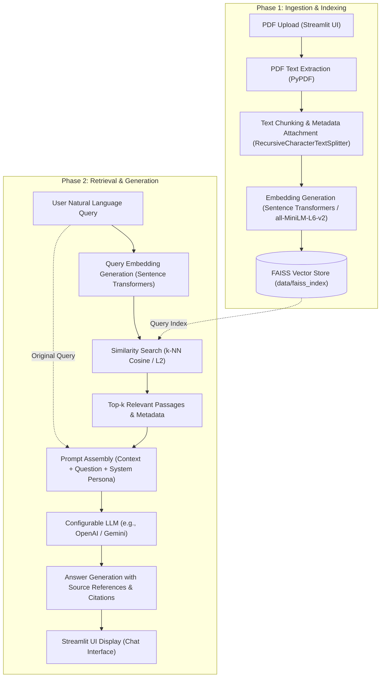

# SmartDocs – System Architecture & RAG Pipeline Design

This document details the planned technical architecture, data pipeline, and system components for **SmartDocs – Generative AI Document Assistant**.

> **Note**: This application is currently under active initialization and design. The architecture outlined below represents the target design for upcoming implementation phases.

---

## 1. High-Level System Workflow

SmartDocs follows an industry-standard Retrieval-Augmented Generation (RAG) architecture. The complete end-to-end lifecycle spans two primary phases:
1. **Document Ingestion & Indexing Pipeline** (Offline / On-Upload)
2. **Retrieval & Generation Pipeline** (Real-time Query Resolution)

---

## 2. Pipeline Stages Explained

### Step 1: PDF Document Upload
- **Component**: `app.py` (Streamlit file uploader widget).
- **Functionality**: Users upload one or more PDF files via the browser interface. The system performs initial file validation (file type verification, size constraints, corrupted header checks).

### Step 2: Text Extraction
- **Component**: `src/document_processor.py` using `pypdf`.
- **Functionality**: Extracts textual content page-by-page while preserving essential document metadata (source file name, page numbers). Unreadable or encrypted files are flagged gracefully.

### Step 3: Text Chunking & Normalization
- **Component**: `src/document_processor.py` using LangChain's `RecursiveCharacterTextSplitter`.
- **Functionality**:
  - Splits long documents into discrete, semantically coherent passages.
  - Default parameters: `chunk_size = 1000` characters, `chunk_overlap = 200` characters.
  - Overlap preserves boundary context across split points.
  - Each chunk retains metadata: `{"source": filename, "page": page_number, "chunk_id": int}`.

### Step 4: Embedding Generation
- **Component**: `src/embeddings.py` using `sentence-transformers/all-MiniLM-L6-v2`.
- **Functionality**:
  - Converts text chunks into dense, fixed-dimension vector representations (384-dimensional embeddings).
  - Operates locally on CPU/GPU without external API latency or cost for embeddings.

### Step 5: FAISS Vector Indexing & Persistence
- **Component**: `src/vector_store.py` using FAISS (Facebook AI Similarity Search).
- **Functionality**:
  - Stores chunk vectors alongside metadata and raw passage text.
  - Supports persistence on disk (`data/faiss_index/`) to eliminate redundant embedding computation on application reboots.

### Step 6: Query Processing & Similarity Search
- **Component**: `src/rag_pipeline.py` & `src/vector_store.py`.
- **Functionality**:
  - Encodes the user's natural language question using the same embedding model.
  - Executes efficient k-nearest neighbors (k-NN) similarity search in the FAISS index.
  - Retrieves the top-$k$ (default: 4) most semantically relevant text chunks.

### Step 7: Augmented Prompt Synthesis
- **Component**: `src/rag_pipeline.py`.
- **Functionality**:
  - Constructs a strictly grounded prompt containing:
    1. System instructions to prevent hallucinations and restrict answering to provided context.
    2. Retrieved document passages with explicit citation identifiers.
    3. User question.

### Step 8: LLM Response Generation & Source Attribution
- **Component**: `src/rag_pipeline.py` interfacing with a configurable LLM provider (e.g., OpenAI `gpt-4o-mini`).
- **Functionality**:
  - The model generates a coherent, factual response.
  - Citations (document name, page number, passage excerpt) are appended to the response for transparency and verification.

---

## 3. Modular Component Responsibilities

| Module | Core Responsibility | Planned Key Classes / Functions |
| :--- | :--- | :--- |
| `app.py` | Streamlit user interface, session state handling, chat rendering. | `main()`, `render_sidebar()`, `render_chat()` |
| `src/document_processor.py` | PDF ingestion, text parsing, and recursive chunking. | `PDFProcessor`, `extract_text()`, `split_documents()` |
| `src/embeddings.py` | Embedding model loading and vector encoding interface. | `EmbeddingManager`, `get_embedding_model()` |
| `src/vector_store.py` | FAISS index creation, persistence, query retrieval. | `VectorStoreManager`, `build_index()`, `load_index()`, `similarity_search()` |
| `src/rag_pipeline.py` | End-to-end orchestration, prompt formatting, LLM invocation. | `RAGPipeline`, `generate_answer()`, `format_sources()` |

---

## 4. Key Design Considerations

1. **Hallucination Mitigation**: Prompts explicitly instruct the LLM to reply "I cannot find the answer based on the provided document" when the context lacks sufficient information.
2. **Provider Agnostic**: The architecture abstracts the LLM interface via LangChain, enabling seamless switching between OpenAI, Google Gemini, Anthropic, or local models (Ollama).
3. **Local Vector Operations**: Utilizing local Sentence Transformers and FAISS ensures sensitive document contents can remain indexed locally with low retrieval latency.
4. **Reproducibility & Testability**: Each component is decoupled to allow isolated unit testing with mock embeddings and mock LLM calls.
