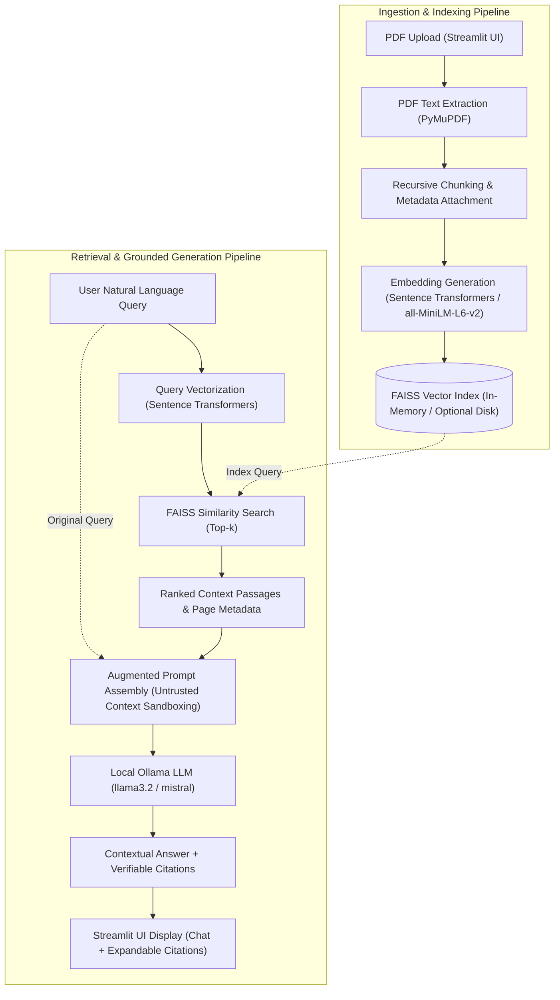

# SmartDocs – System Architecture & RAG Pipeline Design

This document details the production technical architecture, data pipeline, and system components for **SmartDocs – Generative AI Document Assistant**.

---

## 1. High-Level System Workflow

SmartDocs implements an end-to-end Retrieval-Augmented Generation (RAG) architecture running entirely on local inference (PyMuPDF, Sentence Transformers, FAISS, and Ollama).

---

## 2. Pipeline Stages Explained

### Step 1: PDF Document Upload & Validation
- **Component**: `app.py` & `src/document_processor.py`.
- **Functionality**:
  - File extension verification (`.pdf`).
  - File size threshold enforcement (configurable via `MAX_FILE_SIZE_MB`).
  - Magic header check (`%PDF-`).
  - Corruption and password encryption detection.

### Step 2: Page-by-Page Text Extraction
- **Component**: `src/document_processor.py` using **PyMuPDF** (`pymupdf`).
- **Functionality**:
  - Extracts text page-by-page while preserving 1-indexed page numbers.
  - Automatically identifies scanned or image-only PDFs lacking extractable text.
  - Issues clear messages when OCR is required instead of failing silently.

### Step 3: Text Chunking & Metadata Preservation
- **Component**: `src/document_processor.py` using LangChain's `RecursiveCharacterTextSplitter`.
- **Functionality**:
  - Splits document pages into coherent passages using paragraph, sentence, and word boundaries.
  - Configurable `chunk_size` (default 1000) and `chunk_overlap` (default 200).
  - Every chunk attaches metadata: `{"source": filename, "page": page_number, "chunk_index": int, "chunk_id": str}`.

### Step 4: Local Dense Embeddings
- **Component**: `src/embeddings.py` using `sentence-transformers/all-MiniLM-L6-v2`.
- **Functionality**:
  - Encodes text passages into 384-dimensional dense vectors.
  - Model caching via `@st.cache_resource` and lazy-loading prevents duplicate memory footprint.
  - Offline-resilient loading prevents sandbox or network timeouts.

### Step 5: FAISS Vector Indexing & Dynamic Management
- **Component**: `src/vector_store.py` using **FAISS**.
- **Functionality**:
  - High-speed L2 distance semantic search.
  - Session isolation: stored in Streamlit `session_state` to prevent cross-session leakage.
  - Dynamic index rebuilding when documents are added or removed.
  - Optional local disk persistence (`save_local`, `load_local`).

### Step 6: Query Processing & Semantic Similarity Search
- **Component**: `src/vector_store.py` & `src/rag_pipeline.py`.
- **Functionality**:
  - Encodes user queries and retrieves top-$k$ nearest neighbor passages.
  - Computes normalized relevance score: `relevance = 1 / (1 + distance)`.

### Step 7: Prompt Assembly & Prompt Injection Mitigation
- **Component**: `src/rag_pipeline.py`.
- **Functionality**:
  - Context passages are tagged inside `<DOCUMENT_CONTEXT>` boundary tags.
  - Document text is treated as untrusted data to protect against prompt injection instructions inside uploaded documents.
  - Strict grounding prompt: if context is insufficient, explicitly states:
    *"The uploaded documents do not contain enough information to answer this question."*

### Step 8: Local LLM Inference via Ollama
- **Component**: `src/rag_pipeline.py` interfacing with **Ollama** (`http://localhost:11434`).
- **Functionality**:
  - Sends context and query to local models (e.g. `llama3.2`, `mistral`).
  - Active server health checks and model availability validation.
  - Actionable troubleshooting messages when Ollama is offline or models are missing (no fake answers!).

---

## 3. Modular Architecture

| Module | Core Responsibility | Key Classes / Functions |
| :--- | :--- | :--- |
| `app.py` | Streamlit responsive UI, file upload, session state, document manager, chat interface. | `main()`, `render_sidebar()`, `process_uploaded_files()`, `render_chat_section()` |
| `src/document_processor.py` | PyMuPDF text extraction, scanned PDF detection, validation, recursive chunking. | `DocumentProcessor`, `PDFValidationError` |
| `src/embeddings.py` | Sentence Transformers embedding manager, LangChain adapter. | `EmbeddingManager`, `SmartDocsEmbeddings` |
| `src/vector_store.py` | FAISS index lifecycle, similarity search, document deletion & rebuilding. | `VectorStoreManager` |
| `src/rag_pipeline.py` | Grounded prompt synthesis, prompt injection protection, Ollama client. | `RAGPipeline`, `OllamaClient`, `OllamaServerUnavailableError` |
| `src/summarizer.py` | Hierarchical and section-by-section document summarizer. | `DocumentSummarizer`, `SummarizationError` |
